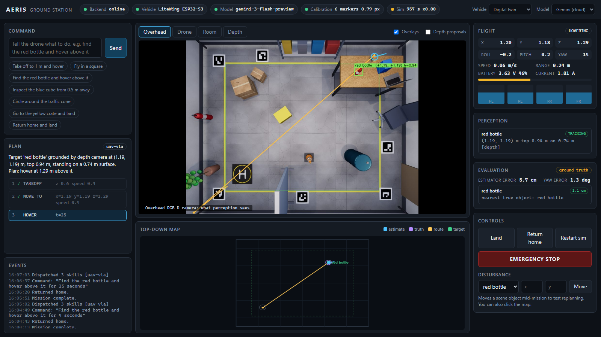
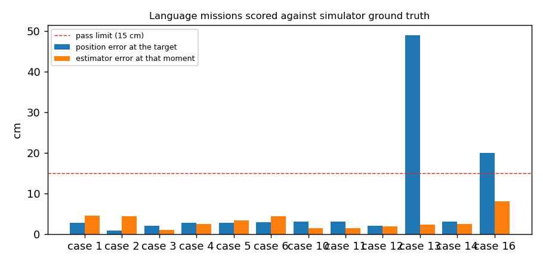
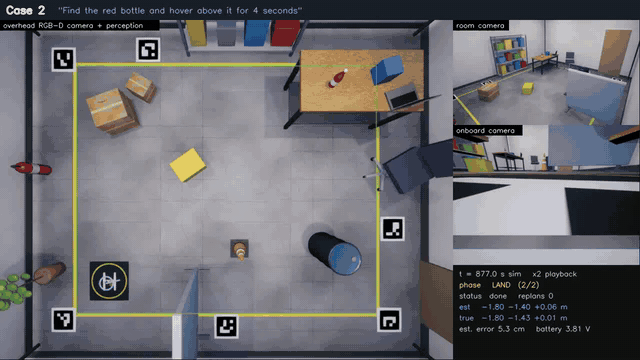
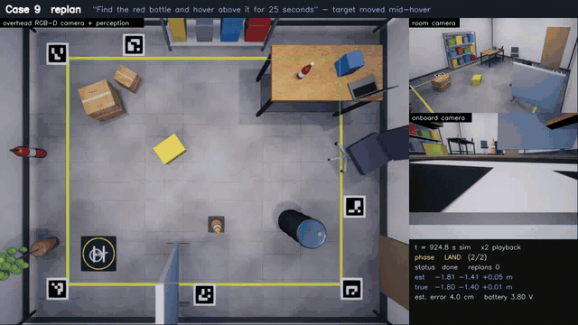

# AERIS: language-guided indoor flight

A closed-loop framework that turns a natural-language instruction into a
validated sequence of drone skills, finds the objects it refers to with a
vision-language model, grounds them in metres, flies there, and replans when
the scene changes. The target vehicle is a LiteWing ESP32-S3 micro-quadrotor;
development and evaluation run against a Simulink / Simscape Multibody /
Unreal digital twin.



```
instruction -> intent / goal -> detection (VLM) -> depth-verified grounding
            -> skill plan -> safety validator -> executor (obstacle-aware routing)
            -> flight controller -> vehicle -> cameras -> tracking -> replan
```

The language and vision models only ever produce skills (`TAKEOFF`, `MOVE_TO`,
`HOVER`, `ROTATE`, `CIRCLE`, `FIND`, `INSPECT`, `RETURN`, `LAND`). Stabilisation
and motor control stay in the flight controller.

## Quick start

```matlab
% MATLAB
cd matlab/twin
run_aeris_twin
```

```bash
pip install -r backend/requirements.txt
cp .env.example .env          # add GEMINI_API_KEY, or use --backend qwen with Ollama
python -m backend.main --drone twin --backend gemini
```

Open http://127.0.0.1:8000 and type, for example, *find the red bottle and
hover above it*.

| `--drone` | What it is |
|---|---|
| `twin` | The digital twin in [matlab/twin](matlab/twin/README.md): physics, sensors, cameras |
| `real` | LiteWing over Wi-Fi |
| `sim` | Kinematic stand-in with no physics and no cameras, for exercising planning and the dashboard without MATLAB |

## The twin

| Room camera | What perception sees | Overhead depth |
|---|---|---|
|  |  |  |

A Simscape Multibody rigid body with contact against the floor, walls and
obstacles; motor, battery, IMU, range and optical-flow models; an onboard
estimator and a cascaded flight controller; and an Unreal lab scene with an
overhead RGB-D camera, an onboard camera and a room camera. The airframe and
the scene are JSON files. Details: [matlab/twin/README.md](matlab/twin/README.md).

## How a visual mission is grounded

1. The overhead camera is calibrated from ArUco markers at surveyed floor
   positions (`backend/vision/calibration.py`).
2. Its depth image is turned into a height map and segmented into physical
   objects, each with a metric position, height and the surface it stands on
   (`backend/vision/scene_proposals.py`). No model is involved yet.
3. The VLM is asked for a box around the thing the instruction names. The box
   must match one of those physical objects; a box on bare floor is rejected
   and the mission is refused (`backend/vision/fast_cv.py`).
4. The object is then followed in the height map, so a moved target triggers
   a replan and a vanished one is reported lost rather than flown to.

This check stops a box on nothing. It does not stop a model that boxes a real
but wrong object; that depends on the model.

## Results

Measured on 12 October 2026 and written up, with a video per test case, in
[reports/twin_results](reports/twin_results/README.md).

| Test | Result |
|---|---|
| Unit tests | 218 passed |
| Controller on the Multibody plant, ground-truth feedback (LiteWing) | 1.4 cm tracking RMSE, 0.1-0.3 cm at waypoints |
| Same flight on the onboard estimator (LiteWing / X500) | 2.4-2.9 cm / 1.3-2.6 cm at waypoints, estimator RMSE 1.9 / 1.5 cm |
| Overhead camera calibration from six markers | 0.78 px reprojection error |
| Hover above an object, four prompts | 0.8-2.8 cm from the object's true position |
| Stand off and face an object, two prompts | 2.1-2.9 cm stand-off error, 0.1-1.3 deg heading error |
| Target that is not in the scene | refused, no flight |
| Target moved 36 cm during the hover | one replan, 5.0 cm from its new true position |



Each language mission was flown and scored once, with
`gemini-robotics-er-2-preview`; two of the eight were re-run after an API
outage refused them on the first pass. The results report lists every
attempt, including a weaker model that failed half the cases.

| Case 2: "Find the red bottle and hover above it for 4 seconds" | Case 9: target moved mid-hover, vehicle replans |
|---|---|
| [](reports/twin_results/videos/case02_find_the_red_bottle_and_hover.mp4) | [](reports/twin_results/videos/case09_replan_moved_target.mp4) |

The previews are time-lapses; click one for the full video. All ten are in
the [results report](reports/twin_results/README.md).

## Reproducing the results

```bash
python -m pytest backend/tests -v                          # no MATLAB needed
```
```matlab
validate_aeris_twin('litewing', 'scene_lab', Truth=true)   % in matlab/twin
validate_aeris_twin('litewing'); validate_aeris_twin('x500')
run_aeris_twin                                             % leave running for the rest
```
```bash
py -3 backend/scripts/twin_smoke_test.py --record          # before starting the backend
python -m backend.main --drone twin --backend gemini       # in a second terminal
py -3 backend/scripts/run_twin_benchmark.py --record
py -3 backend/scripts/twin_replan_test.py --record
py -3 backend/scripts/build_twin_report.py                 # writes reports/twin_results/README.md
```

The benchmark compares where the vehicle truly was while hovering with where
the referenced object truly is. Ground truth comes from the twin and is used
for scoring only.

### Baselines and ablations

Every command can name a run mode (`mode` in the `/api/command` body, or
`AERIS_RUN_MODE` for the default); each one switches components off in the
same backend:

| Mode | What is different |
|---|---|
| `full` | nothing: the closed-loop system |
| `scripted` | B0: flies waypoints sent with the command; no models, no perception |
| `open_loop` | B3: plans once with the LLM/VLM, then flies without tracking or replanning |
| `no_vlm` | B1: the LLM plans from a prior object map sent with the command |
| `no_depth_check` | VLM boxes grounded by floor projection, without depth verification |
| `no_replan` | tracking on, but target drift never changes the plan |
| `safety_shadow` | validator verdict recorded but not enforced (twin and sim only) |

The benchmark runs the matrix and writes one row per trial to
`reports/twin_results/metrics/trials.csv`:

```bash
py -3 backend/scripts/run_twin_benchmark.py --modes full open_loop scripted no_replan \
    --disturbances none move_target remove_target delay_250 --seeds 10 --randomize --paraphrase
```

A seed fixes the layout, wording and disturbance for every mode, so modes are
compared on identical trials. The plan cache stays on: plans built from a
live detection are never cached, so object missions call the VLM every
trial, and each row's `cache_hit` marks text plans the cache answered.
Statistics for one or more trial CSVs (success rates with Wilson 95%
intervals, median [IQR] errors and latencies, paired exact McNemar tests
against `full`, and a safety table) go to `metrics/analysis.md`:

```bash
py -3 backend/scripts/analyze_trials.py                      # reports/twin_results/metrics/trials.csv
py -3 backend/scripts/analyze_trials.py lab.csv distractor.csv --by-scenario
```

Wrong-object grounding is tested in `scene_distractor`, which is `scene_lab`
plus a green bottle on the workbench and a red box on the floor. Start the
twin with `run_aeris_twin('litewing', 'scene_distractor')`; the benchmark
then runs scenarios 20 to 23 and the ones whose answer is unchanged, and
records `wrong_object` when the vehicle went to the look-alike.

Each mission's trace (mode, planner, every model call with its model
ID, latency and raw output, stage timings, steps, replans, lost targets) is at
`/api/trace` and is appended to `cache/traces/traces.jsonl`.

## Layout

| Path | What it holds |
|---|---|
| `backend/planning/` | Intent routing, rule-based planner, UAV-VLA pipeline, safety validator, obstacle-aware route planner |
| `backend/vision/` | Marker calibration, depth proposals, grounding, tracking, perception loop, camera position and heading fixes |
| `backend/runtime/` | Mission executor, replanning, state store, event bus |
| `backend/drone/` | One interface, three backends: `twin`, `real` (LiteWing), `sim` |
| `backend/models/` | Gemini and Qwen providers behind a common interface |
| `backend/api/` | FastAPI server: commands, config, video, telemetry, evaluation |
| `backend/scripts/` | Twin test commands, the video recorder and the report builder |
| `backend/tests/` | Unit tests |
| `frontend/` | Ground-station dashboard |
| `matlab/twin/` | The digital twin |
| `reports/twin_results/` | Results report, metrics, logs, videos and images |

## Status

* Simulation: the full loop runs against the twin.
* Hardware: the LiteWing backend exists but has not been flown with this
  stack. The twin's propulsion constants are scaled from published Crazyflie
  data and are not yet identified on the real airframe.
* The Gemini free tier allows about 20 requests per model per day; a
  benchmark run uses about ten. Object missions need a VLM request per
  trial, so a large evaluation matrix needs a paid tier or the local models.
