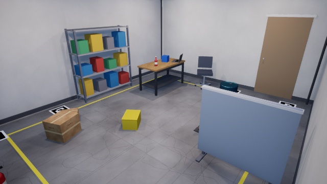
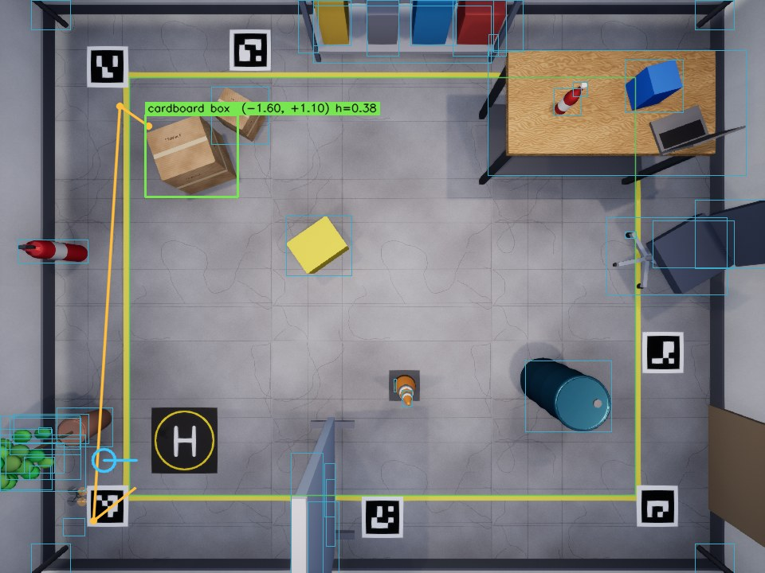
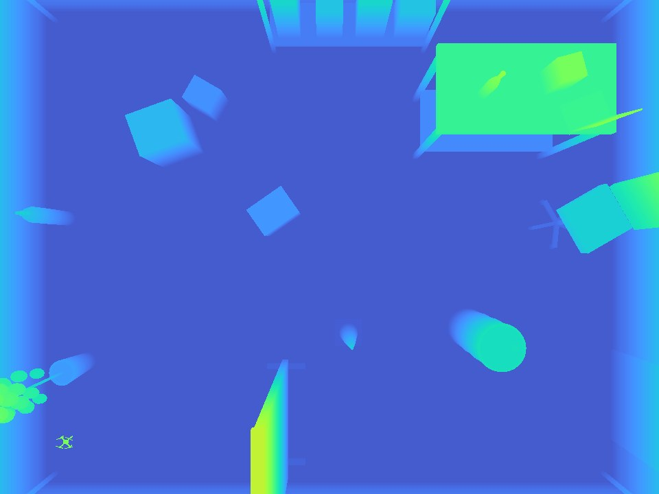

# AERIS digital twin

A physics, sensing and rendering twin of the indoor flight setup, built on
Simulink, Simscape Multibody and Simulink 3D Animation (Unreal Engine). The
Python stack drives it through the same skill-level interface it uses for the
real vehicle, and sees the world only through the twin's cameras.

| Room camera | Overhead RGB with perception overlay | Overhead depth |
|---|---|---|
|  |  |  |

Measured results, with a video per test case, are in
[reports/twin_results](../../reports/twin_results/README.md).

Tested on MATLAB R2026b with Simulink, Simscape, Simscape Multibody, UAV
Toolbox, Simulink 3D Animation, Instrument Control Toolbox and MATLAB Coder
(MinGW compiler).

## Run it

```matlab
cd matlab/twin
run_aeris_twin                 % LiteWing in the lab scene
```

```bash
python -m backend.main --drone twin --backend gemini
# open http://127.0.0.1:8000
```

The first start takes a few minutes (model generation, code generation for
the control blocks, Unreal start-up). `--launch-twin` makes the backend start
MATLAB itself.

Other entry points:

| Command | Purpose |
|---|---|
| `run_aeris_twin('x500')` | Pixhawk-class airframe with PX4 Gazebo x500 parameters |
| `run_aeris_twin('litewing', 'scene_lab', Render=false)` | Physics and link only, no Unreal (about 1.5x real time) |
| `run_aeris_twin(Truth=true)` | Controller flies on ground truth: isolates control from estimation |
| `validate_aeris_twin` | Scripted closed-loop flight, no Python: step response, tracking and estimator metrics, plots |
| `preview_scene` | Render the scene's cameras to `cache/twin_preview` without running the plant |
| `py -3 backend/scripts/twin_smoke_test.py` | Link, cameras, calibration and a short flight (backend not running) |
| `py -3 backend/scripts/run_twin_benchmark.py` | Natural-language missions scored against ground truth |
| `py -3 backend/scripts/twin_replan_test.py` | Moves the target mid-hover and checks the replan |
| `py -3 backend/scripts/build_twin_report.py` | Assembles `reports/twin_results/README.md` from the outputs of the commands above |

The three Python test scripts take `--record`, which writes one video and one
still per test case to `reports/twin_results`.

## What is modelled

| Part | Model | Where |
|---|---|---|
| Rigid body | Simscape Multibody 6-DOF body with the airframe's mass and inertia | `build_aeris_twin.m` |
| Contact | Four point-contact feet and a collision hull against the floor, walls, ceiling and every `collide` object in the scene | `build_aeris_twin.m` |
| Propulsion | Per-rotor thrust at the hubs; first-order motor lag (separate spin-up and spin-down); thrust and torque from rotor speed squared; ground effect; rotor reaction, spin-up and gyroscopic torque | `+aeris/Propulsion.m` |
| Aerodynamics | Rotor drag linear in airspeed, quadratic frame drag, mean wind plus coloured gusts | `+aeris/Propulsion.m` |
| Battery | Open-circuit voltage curve, internal resistance, current from mechanical power; speed sags with pack voltage | `+aeris/Propulsion.m` |
| IMU | Gyro and accelerometer white noise, turn-on bias, gyro bias walk | `+aeris/Sensors.m` |
| Range sensor | Downward time-of-flight to the surface actually below (floor, table, box), tilt and range limits | `+aeris/Sensors.m` |
| Optical flow | Body-frame velocity, noise growing with height, minimum height | `+aeris/Sensors.m` |
| Estimator | Mahony attitude filter, gyro bias from a boot-window average, fixed-gain height and velocity observers with a terrain state, dead-reckoned position, optional external position and heading fix | `+aeris/Sensors.m` |
| Controller | Setpoint shaping, position P, velocity PI, quaternion attitude P, body-rate PID, mixer with yaw-first desaturation, battery compensation, touchdown detection | `+aeris/Controller.m` |
| Scene | Unreal room built from `config/scene_lab.json`: textured shell, lighting, furniture and props, ArUco floor markers | `+aeris/buildScene.m`, `+aeris/objectMesh.m` |
| Cameras | Overhead RGB-D, onboard forward camera, fixed room camera | `+aeris/cameraSpecs.m` |

Rates: plant 1 kHz (fixed-step ode3), propulsion and sensors 1 kHz, controller
500 Hz, link 50 Hz, Unreal 10 Hz, camera frames 5 Hz. Change them in
`+aeris/loadParams.m`.

## Configuration

Two JSON files are the only place a physical or scene value is written:

* `config/airframe_<name>.json`: mass, inertia, rotor constants, battery,
  sensor noise, controller bandwidths. Controller gains are derived from the
  bandwidths, not tuned per scene.
* `config/scene_lab.json`: room, workspace, home pad, wind, cameras, marker
  positions and objects. Add or move an object here and it appears in Unreal,
  in the contact model (if `"collide": true`) and in the range-sensor terrain.
  Run `py -3 backend/scripts/make_twin_assets.py` after changing the markers.

The model `models/aeris_twin.slx` is generated from these on every start and
is not version-controlled.

## Interface to Python

| Channel | Direction | Content |
|---|---|---|
| UDP 5005 | to twin | JSON commands: `TAKEOFF{z}`, `MOVE_TO{x,y,z,velocity,yaw}`, `HOVER`, `ROTATE{angle}`, `LAND`, `EMERGENCY`, `HOME`, `SET_OBJECT{name,x,y,z}`, `EXT_POSE{x,y[,yaw]}`, `RESTART`, `STOP` |
| UDP 5006 | from twin | JSON telemetry at 50 Hz: estimated state at top level, plant truth under `truth`, motors, battery, range, controller reference |
| TCP 5007 | from twin | Camera frames: overhead RGB, overhead depth (uint16 mm), onboard, room |
| `cache/twin_runtime.json` | from twin | Ports, camera intrinsics, marker survey, workspace, airframe summary, and ground truth for scoring |

Commands are setpoints for the flight controller. No motor command crosses
the link.

### What the Python side is allowed to know

The planner and the perception stack use the camera frames, the estimated
state, the camera intrinsics, the surveyed marker positions and the workspace
limits, which is what a real lab also provides. Object poses and the plant's
true state are published for scoring (`/api/eval`, `run_twin_benchmark.py`)
and are not read anywhere in the planning or perception path.

### How drift is held down

Onboard, horizontal position and heading are dead-reckoned and drift. The
Python side corrects both from the overhead camera
(`backend/vision/scene_service.py`): whenever the vehicle is near-stationary
it finds the airframe in the depth image and sends its position, and over
each leg between two fixes it compares the displacement the estimator reports
with the one the camera saw; the angle between them is the heading error. A
fix is accepted only if it is the size of the airframe and within a gate that
widens with the distance flown since the last fix.

## Known limits

* Propulsion constants for the LiteWing are scaled from published Crazyflie
  identification, not measured on the airframe. Replace them in
  `airframe_litewing.json` after a thrust-stand test; until then, absolute
  numbers such as hover throttle are indicative.
* Rotors are not spinning bodies in Simscape. Their gyroscopic and reaction
  torques are applied analytically, as in RotorS and the PX4 Gazebo plugins.
* The overhead camera cannot see what is hidden behind or under tall objects,
  and tall objects near the walls are partly outside its field of view. The
  obstacle map treats unseen space as free; the workspace limits keep the
  vehicle away from the walls.
* With rendering on, the twin runs below real time on a laptop GPU (about
  0.6-0.7x on an RTX 3050). Mission timing follows the simulation clock, so
  results are unaffected, but model latency is then shorter in simulated time
  than it would be in a real flight.
* PX4 software-in-the-loop is not wired in. The controller has the PX4 /
  Crazyflie cascade structure but is this project's own implementation; the
  PX4 host target needs WSL, which is not installed on the development PC.
