# AERIS digital twin: results and metrics

Generated 2026-10-21 12:04 by `backend/scripts/build_twin_report.py` from the files in `metrics/` and `logs/`. Every number below was written by a test run; nothing is typed in by hand.

## 1. Unit tests

`py -3 -m pytest backend/tests -v` (no simulator needed)

Result: **218 passed, 1 warning**. Full output: [logs/01_unit_tests.log](logs/01_unit_tests.log)

## 2. Twin flight validation (MATLAB only, no Python, no language model)

`validate_aeris_twin` flies take-off, a square of four waypoints, a 90 degree yaw step and a landing on the Simscape Multibody plant. Log: [logs/02_twin_validation.log](logs/02_twin_validation.log)

| Metric | LiteWing, controller on ground truth | LiteWing, onboard estimator | X500, onboard estimator |
|---|---|---|---|
| Hover throttle | 0.64 | 0.64 | 0.71 |
| Hover rotor speed (rpm) | 11179 | 11178 | 7224 |
| Take-off settle to 5 cm (s) | 1.43 | 1.35 | 1.51 |
| Take-off overshoot (cm) | 0 | 0 | 7.2 |
| Tracking RMSE (cm) | 1.4 | 4.8 | 6.6 |
| Tracking max error (cm) | 5.4 | 13.1 | 16.9 |
| Waypoint arrival error (cm) | 0.3 / 0.3 / 0.1 / 0.2 | 2.7 / 2.9 / 2.4 / 2.5 | 1.4 / 1.3 / 2.6 / 2.3 |
| Max tilt (deg) | 18.4 | 18.8 | 16.9 |
| Yaw after 90 deg step (deg) | 90.0 | 90.1 | 89.7 |
| Estimator RMSE (cm) | 0 | 1.9 | 1.5 |
| Estimator final xy drift (cm) | 0 | 1.8 | 1.5 |
| Landed | yes | yes | yes |
| Landing xy error (cm) | 0.1 | 2.3 | 1.8 |
| Battery used (%) | 3.16 | 3.16 | 4.34 |
| Minimum voltage (V) | 3.93 | 3.90 | 15.96 |
| Real-time factor, no rendering | 0.91 | 2.30 | 1.11 |

**LiteWing, controller on ground truth**

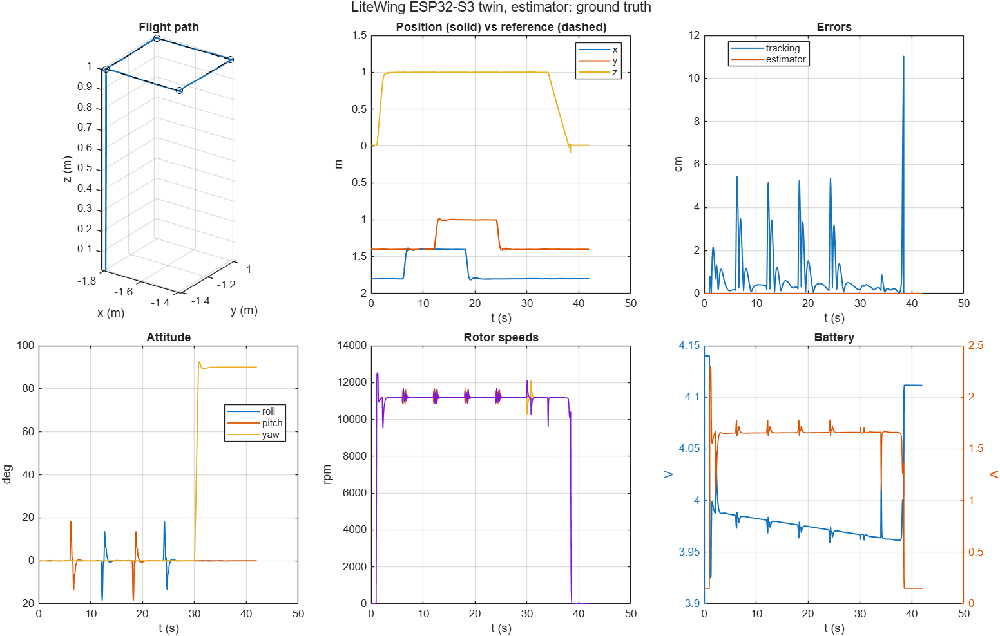

**LiteWing, onboard estimator**

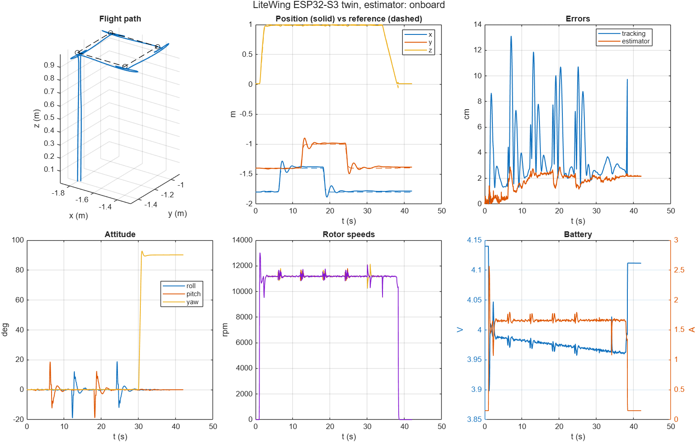

**X500, onboard estimator**

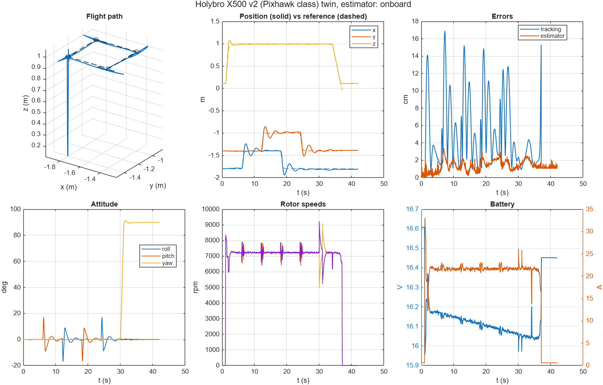

## 3. Link check (Python to twin, no language model)

`py -3 backend/scripts/twin_smoke_test.py --record` checks telemetry, the camera streams, the marker calibration of the overhead camera and a short scripted flight. The backend is not running, so the vehicle flies on its onboard estimator alone, with no camera fixes.

```text
telemetry ok: pose=(-1.80, -1.40, 0.01) battery=4.14 V
cameras: ['chase', 'fpv', 'overhead']
depth: (720, 960) range 1.72..2.92 m
calibration: markers [0, 1, 2, 3, 4, 5], reprojection 0.78 px, camera at [0.003, -0.003, 2.915]
takeoff: True  z=0.97  est-vs-truth 0.1 cm
move_to (-0.8, -0.6, 1.0):  7.4 s  true=(-0.77, -0.58, 0.99)  true error 3.7 cm
move_to (+0.4, -0.2, 1.2):  7.3 s  true=(+0.46, -0.16, 1.19)  true error 7.7 cm
move_to (+0.0, +0.6, 0.8):  6.5 s  true=(+0.05, +0.64, 0.79)  true error 6.6 cm
rotate: yaw=89 deg (true 89)
land: True  z=0.031  battery=4.01 V (93%)
PASS
```

[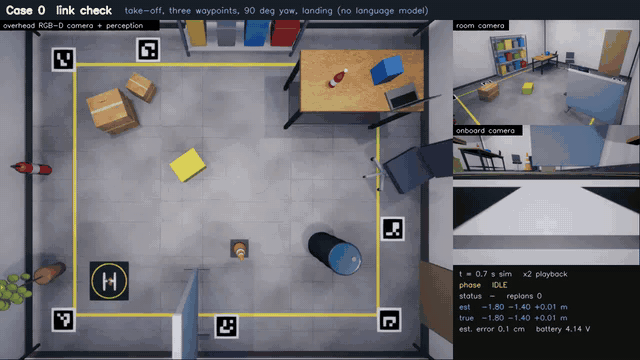](videos/case00_link_smoke_flight.mp4)

Preview above; full video: [videos/case00_link_smoke_flight.mp4](videos/case00_link_smoke_flight.mp4)

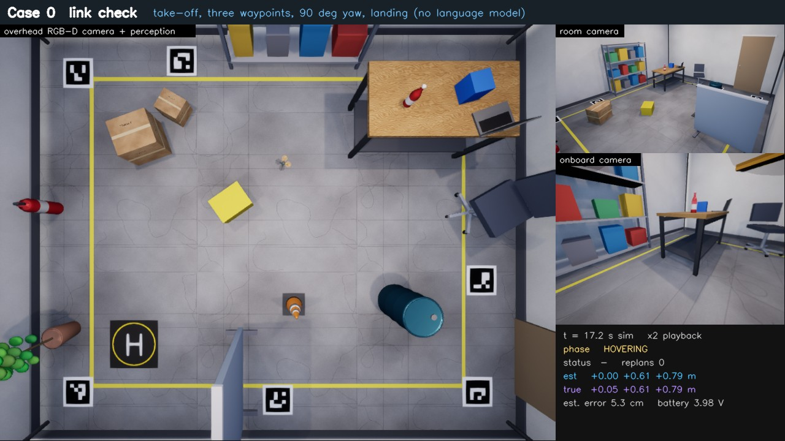

| overhead | fpv | chase | overhead depth | depth proposals and a grounded target |
|---|---|---|---|---|
| 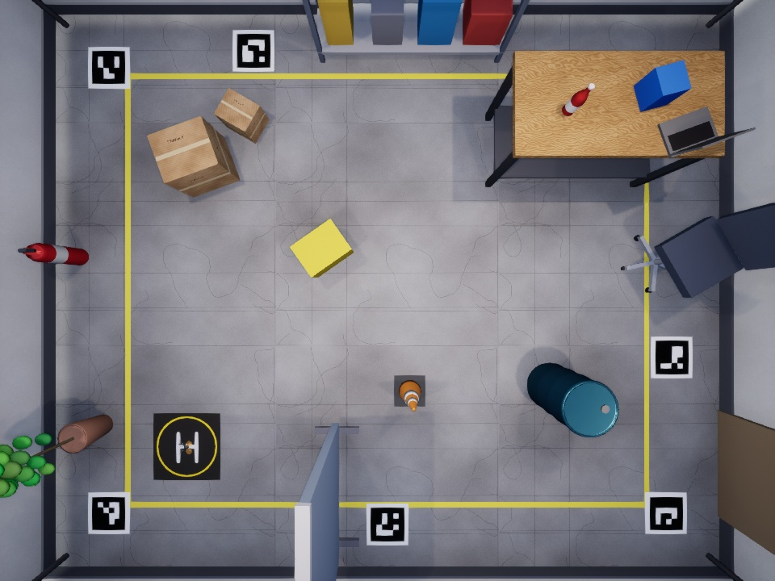 | 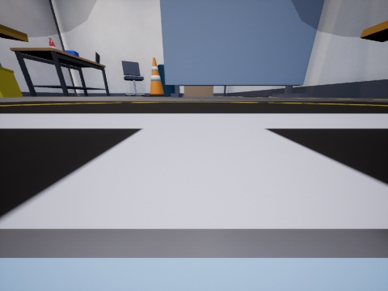 |  |  |  |

## 4. Language missions on the twin

`py -3 backend/scripts/run_twin_benchmark.py --record` sends each prompt to the running backend. A case passes when the vehicle's true position while hovering is within 15 cm of where the prompt asks it to be relative to the object's true position (and within 15 degrees of facing it, for inspection cases). Ground truth is used for scoring only; the planner and the perception stack never see it.

Run 2026-10-21 11:41:20, airframe LiteWing ESP32-S3, scene scene_lab, model gemini-3.6-flash: **16/16 passed**. Each case has one scored flight. Cases 1, 2, 10, 11, 12, 13, 14, 15, 16, 17 were re-run; section 7 says why.

Log: [logs/04_language_missions.log](logs/04_language_missions.log), data: [metrics/benchmark.json](metrics/benchmark.json), [metrics/benchmark.csv](metrics/benchmark.csv)

| Case | Prompt | Status | Pass | Target error (cm) | Stand-off error (cm) | Heading error (deg) | Estimator error (cm) | Clearance (m) | Flight time (s, sim) | Path (m) | Plan latency (s, wall) | Replans | Re-run |
|---|---|---|---|---|---|---|---|---|---|---|---|---|---|
| 1 | Find the cardboard box and hover above it | done | yes | 2.8 | - | - | 4.5 | 0.28 | 13.2 | 3.64 | 4.4 | 0 | yes |
| 2 | Find the red bottle and hover above it for 4 seconds | done | yes | 0.8 | - | - | 4.4 | 0.24 | 18.7 | 5.65 | 12.5 | 0 | yes |
| 3 | Inspect the blue cube from 0.5 m away | done | yes | - | 2.1 | 1.3 | 1.0 | - | 19.2 | 5.88 | 7.1 | 0 | - |
| 4 | Find the steel drum and hover above its center | done | yes | 2.8 | - | - | 2.5 | 0.31 | 15.8 | 4.62 | 3.8 | 0 | - |
| 5 | Go to the yellow crate | done | yes | 2.8 | - | - | 3.4 | 0.31 | 11.2 | 3.10 | 3.4 | 0 | - |
| 6 | Find the traffic cone and hover facing it | done | yes | - | 2.9 | 0.1 | 4.4 | - | 10.0 | 2.89 | 6.2 | 0 | - |
| 7 | Take off to 0.8 m and fly in a square | done | yes | - | - | - | - | - | 23.0 | 8.17 | 0.1 | 0 | - |
| 8 | Find the purple elephant and hover above it | refused | yes | - | - | - | - | - | - | - | 3.8 | - | - |
| 10 | Find cardboard box and hover it | done | yes | 3.1 | - | - | 1.4 | 0.32 | 13.0 | 3.54 | 12.9 | 0 | yes |
| 11 | Find the shiny red bottle next to the blue cube and hover facing it | done | yes | - | 3.0 | 0.4 | 1.4 | - | 15.0 | 4.63 | 6.5 | 0 | yes |
| 12 | Find the bottle that is left of the blue cube and inspect it from 0.4 m away | done | yes | - | 2.1 | 0.7 | 1.9 | - | 14.2 | 4.59 | 19.6 | 0 | yes |
| 13 | Find the red bottle if it is in front of the cube, otherwise look at the cube | done | yes | 49.0 | - | - | 2.4 | - | 14.5 | 4.57 | 14.8 | 0 | yes |
| 14 | Look at the cylindrical object and hover above its center | done | yes | 3.1 | - | - | 2.5 | 0.30 | 16.1 | 4.63 | 20.5 | 0 | yes |
| 15 | Fly 0.5m and make a square in air | done | yes | - | - | - | - | - | 25.5 | 8.17 | 0.0 | 0 | yes |
| 16 | Hover at the end of the wall | done | yes | 20.0 | - | - | 8.1 | - | 9.3 | 2.74 | 14.0 | 0 | yes |
| 17 | Fly in a star pattern | done | yes | - | - | - | - | - | 33.5 | 9.03 | 0.1 | 0 | yes |


### Case 1: "Find the cardboard box and hover above it"

Result: **PASS** (done). Plan: TAKEOFF > MOVE_TO > HOVER.

> Target 'cardboard box' grounded by depth camera at (-1.60, 1.10) m, top 0.38 m. Plan: hover at 0.72 m above it.

[](videos/case01_find_the_cardboard_box_and_hover.mp4)

Preview above; full video: [videos/case01_find_the_cardboard_box_and_hover.mp4](videos/case01_find_the_cardboard_box_and_hover.mp4)

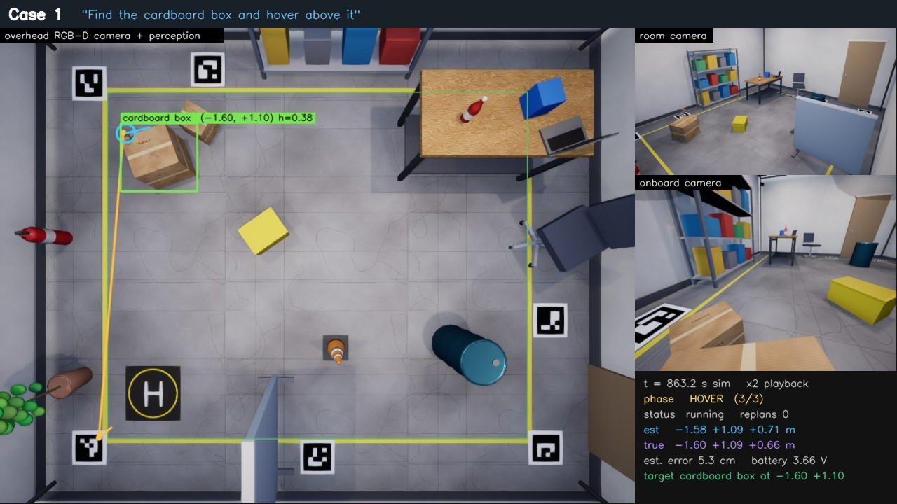

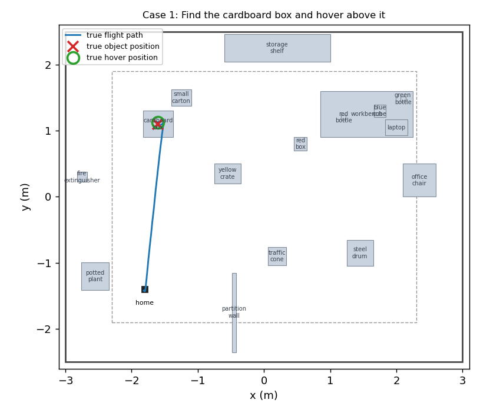

### Case 2: "Find the red bottle and hover above it for 4 seconds"

Result: **PASS** (done). Plan: TAKEOFF > MOVE_TO > HOVER.

> Target 'red bottle' grounded by depth camera at (1.19, 1.19) m, top 0.94 m, standing on a 0.74 m surface. Plan: hover at 1.29 m above it.

[](videos/case02_find_the_red_bottle_and_hover.mp4)

Preview above; full video: [videos/case02_find_the_red_bottle_and_hover.mp4](videos/case02_find_the_red_bottle_and_hover.mp4)

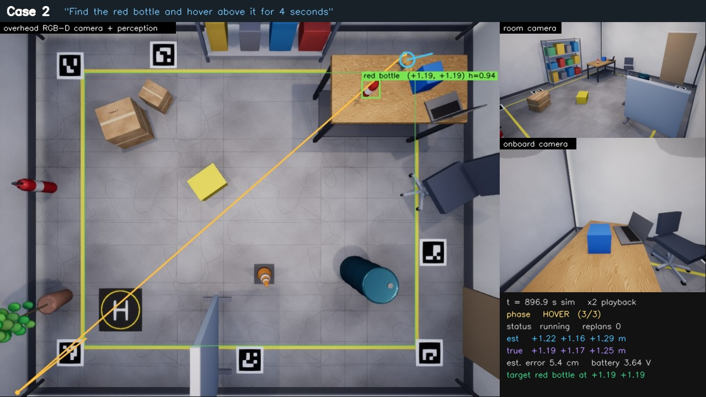

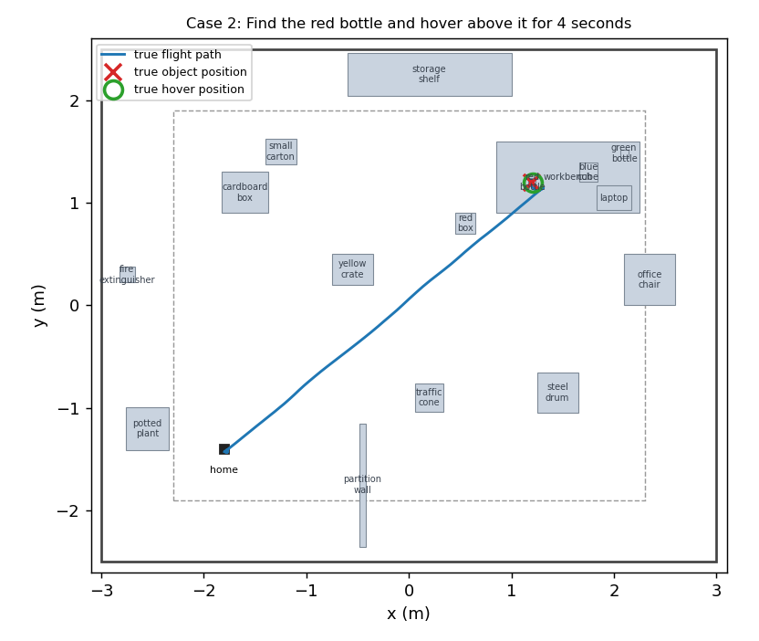

### Case 3: "Inspect the blue cube from 0.5 m away"

Result: **PASS** (done). Plan: TAKEOFF > MOVE_TO > ROTATE > HOVER.

> Target 'blue cube' grounded by depth camera at (1.75, 1.30) m, top 0.93 m, standing on a 0.74 m surface. Plan: view from 0.50 m, heading 37 deg.

[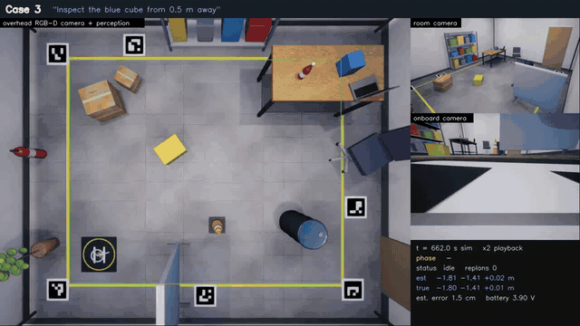](videos/case03_inspect_the_blue_cube_from_0.mp4)

Preview above; full video: [videos/case03_inspect_the_blue_cube_from_0.mp4](videos/case03_inspect_the_blue_cube_from_0.mp4)

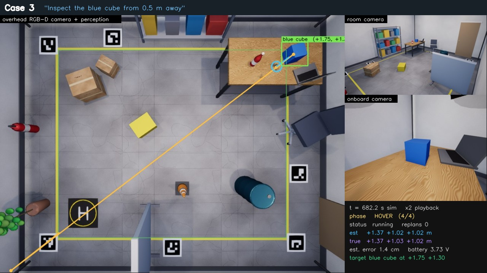

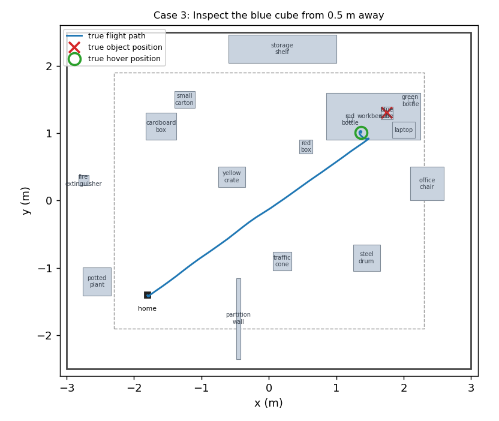

### Case 4: "Find the steel drum and hover above its center"

Result: **PASS** (done). Plan: TAKEOFF > MOVE_TO > HOVER.

> Target 'steel drum' grounded by depth camera at (1.45, -0.85) m, top 0.59 m. Plan: hover at 0.94 m above it.

[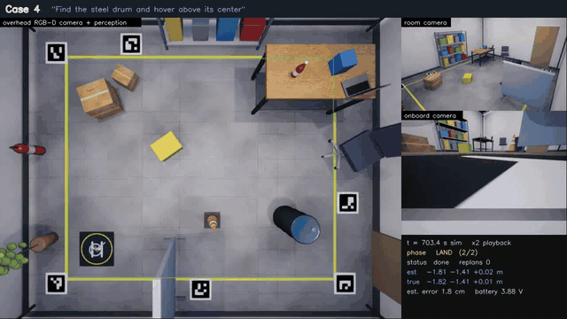](videos/case04_find_the_steel_drum_and_hover.mp4)

Preview above; full video: [videos/case04_find_the_steel_drum_and_hover.mp4](videos/case04_find_the_steel_drum_and_hover.mp4)

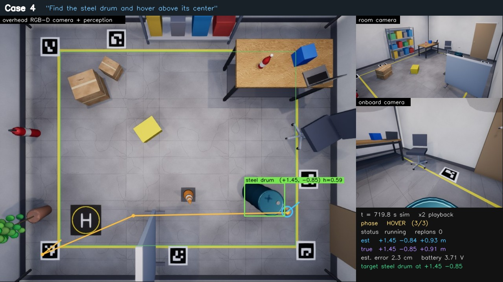

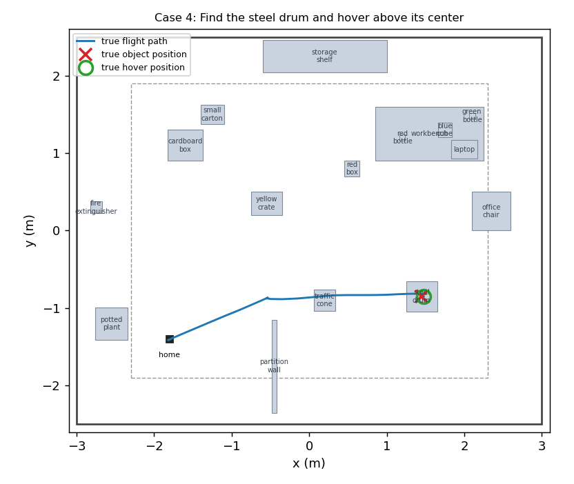

### Case 5: "Go to the yellow crate"

Result: **PASS** (done). Plan: TAKEOFF > MOVE_TO > HOVER.

> Target 'yellow crate' grounded by depth camera at (-0.57, 0.35) m, top 0.23 m. Plan: hover at 0.60 m above it.

[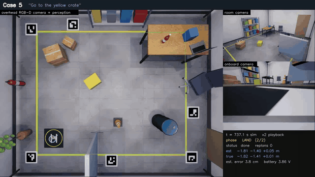](videos/case05_go_to_the_yellow_crate.mp4)

Preview above; full video: [videos/case05_go_to_the_yellow_crate.mp4](videos/case05_go_to_the_yellow_crate.mp4)

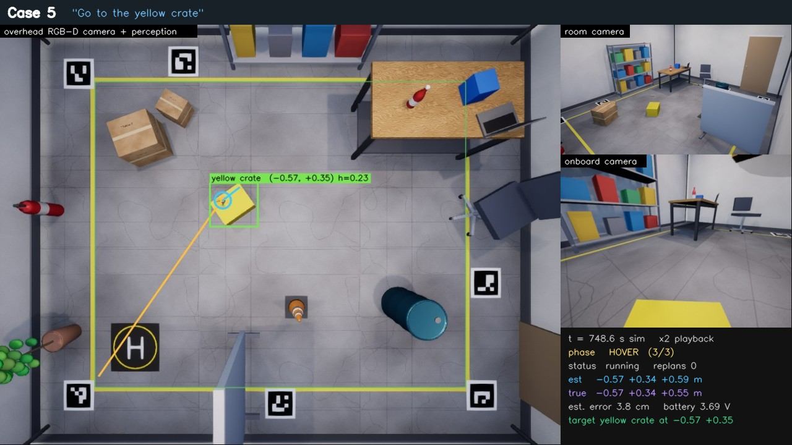

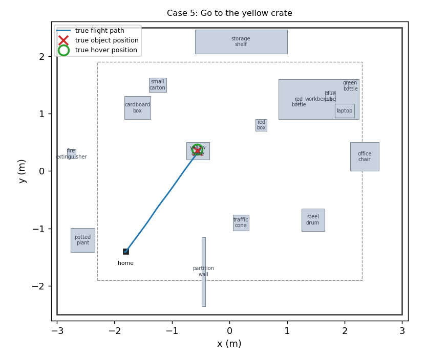

### Case 6: "Find the traffic cone and hover facing it"

Result: **PASS** (done). Plan: TAKEOFF > MOVE_TO > ROTATE > HOVER.

> Target 'traffic cone' grounded by depth camera at (0.19, -0.89) m, top 0.46 m, standing on a 0.22 m surface. Plan: view from 0.50 m, heading 14 deg.

[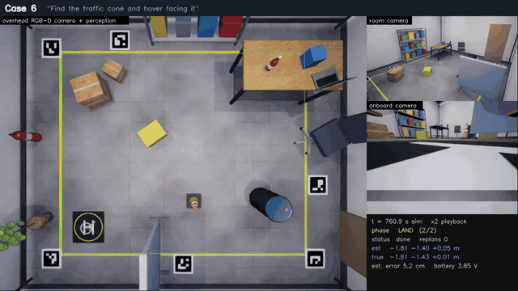](videos/case06_find_the_traffic_cone_and_hover.mp4)

Preview above; full video: [videos/case06_find_the_traffic_cone_and_hover.mp4](videos/case06_find_the_traffic_cone_and_hover.mp4)

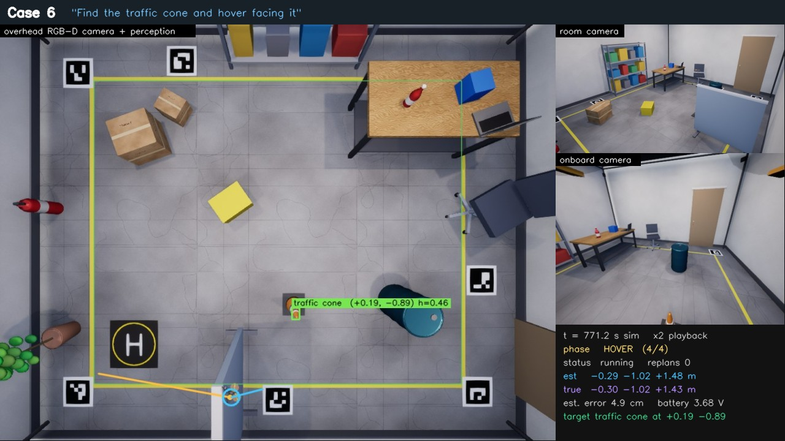

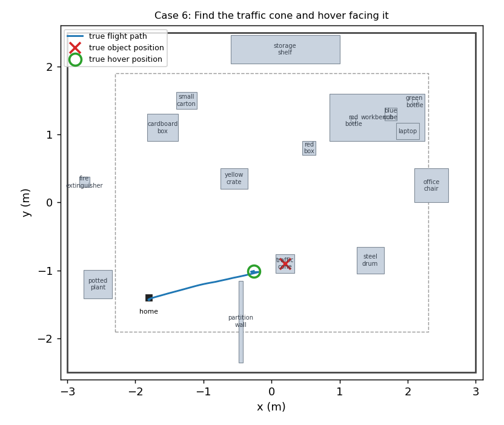

### Case 7: "Take off to 0.8 m and fly in a square"

Result: **PASS** (done). Plan: TAKEOFF > MOVE_TO > MOVE_TO > MOVE_TO > MOVE_TO > MOVE_TO.

> [CODE] intent=shape | NeLV parser→route→path→control

[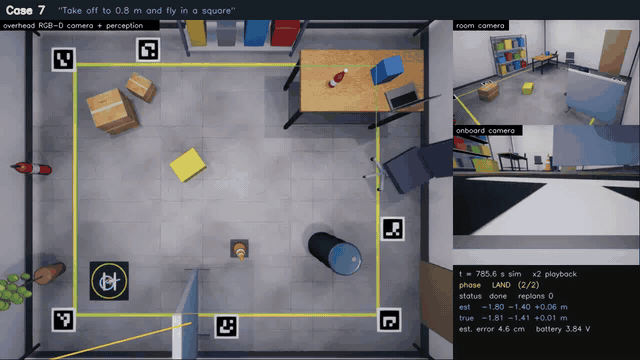](videos/case07_take_off_to_0_8_m.mp4)

Preview above; full video: [videos/case07_take_off_to_0_8_m.mp4](videos/case07_take_off_to_0_8_m.mp4)

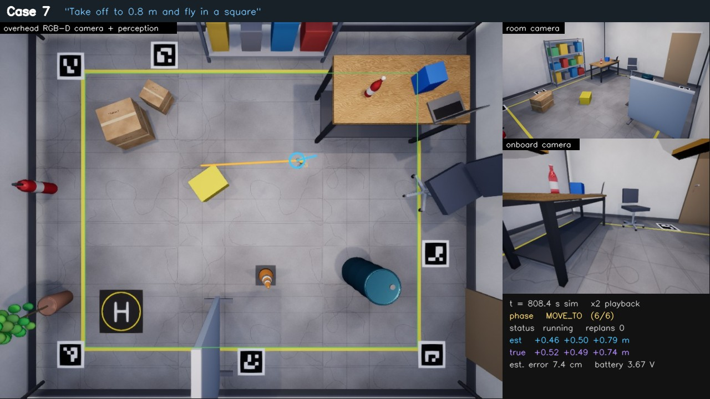

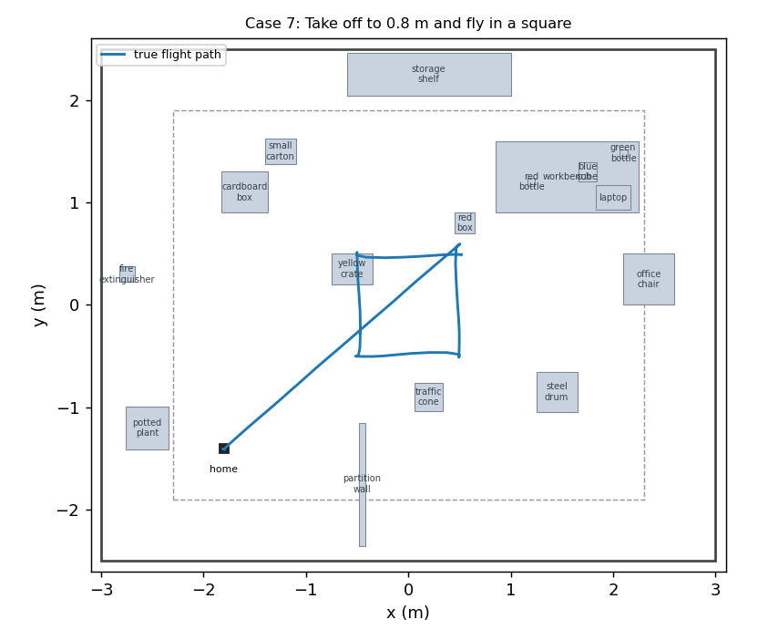

### Case 8: "Find the purple elephant and hover above it"

Result: **PASS** (refused). Plan: none.

> Target 'purple elephant': not found in the camera view, or nothing physical is at the detected location. No plan generated.

[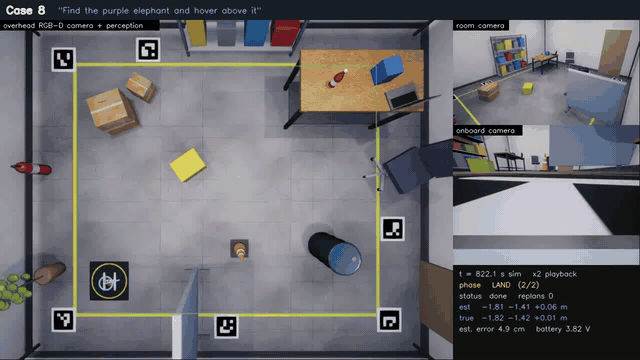](videos/case08_find_the_purple_elephant_and_hover.mp4)

Preview above; full video: [videos/case08_find_the_purple_elephant_and_hover.mp4](videos/case08_find_the_purple_elephant_and_hover.mp4)

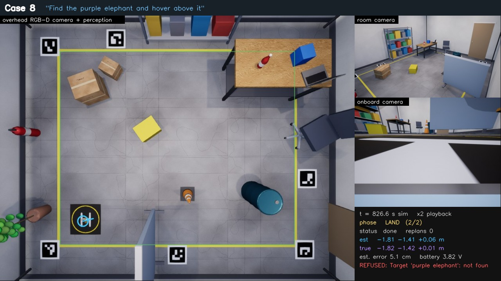

### Case 10: "Find cardboard box and hover it"

Result: **PASS** (done). Plan: TAKEOFF > MOVE_TO > HOVER.

> Target 'cardboard box' grounded by depth camera at (-1.60, 1.10) m, top 0.38 m. Plan: hover at 0.72 m above it.

[](videos/case10_find_cardboard_box_and_hover_it.mp4)

Preview above; full video: [videos/case10_find_cardboard_box_and_hover_it.mp4](videos/case10_find_cardboard_box_and_hover_it.mp4)


### Case 11: "Find the shiny red bottle next to the blue cube and hover facing it"

Result: **PASS** (done). Plan: TAKEOFF > MOVE_TO > ROTATE > HOVER.

> Target 'shiny red bottle next to the blue cube' grounded by depth camera at (1.19, 1.19) m, top 0.94 m, standing on a 0.74 m surface. Plan: view from 0.50 m, heading 41 deg.

[](videos/case11_find_the_shiny_red_bottle_next.mp4)

Preview above; full video: [videos/case11_find_the_shiny_red_bottle_next.mp4](videos/case11_find_the_shiny_red_bottle_next.mp4)


### Case 12: "Find the bottle that is left of the blue cube and inspect it from 0.4 m away"

Result: **PASS** (done). Plan: TAKEOFF > MOVE_TO > ROTATE > HOVER.

> Target 'bottle that is left of the blue cube' grounded by depth camera at (1.19, 1.19) m, top 0.94 m, standing on a 0.74 m surface. Plan: view from 0.40 m, heading 41 deg.

[](videos/case12_find_the_bottle_that_is_left.mp4)

Preview above; full video: [videos/case12_find_the_bottle_that_is_left.mp4](videos/case12_find_the_bottle_that_is_left.mp4)


### Case 13: "Find the red bottle if it is in front of the cube, otherwise look at the cube"

Result: **PASS** (done). Plan: TAKEOFF > MOVE_TO > ROTATE > HOVER.

> Target 'red bottle that is in front of the cube' grounded by depth camera at (1.19, 1.19) m, top 0.94 m, standing on a 0.74 m surface. Plan: view from 0.50 m, heading 41 deg. Condition checked: 'in front of the cube'.

[](videos/case13_find_the_red_bottle_if_it.mp4)

Preview above; full video: [videos/case13_find_the_red_bottle_if_it.mp4](videos/case13_find_the_red_bottle_if_it.mp4)


### Case 14: "Look at the cylindrical object and hover above its center"

Result: **PASS** (done). Plan: TAKEOFF > MOVE_TO > ROTATE > HOVER.

> Target 'cylindrical object' grounded by depth camera at (1.45, -0.85) m, top 0.59 m. Plan: hover at 0.94 m above it.

[](videos/case14_look_at_the_cylindrical_object_and.mp4)

Preview above; full video: [videos/case14_look_at_the_cylindrical_object_and.mp4](videos/case14_look_at_the_cylindrical_object_and.mp4)


### Case 15: "Fly 0.5m and make a square in air"

Result: **PASS** (done). Plan: TAKEOFF > MOVE_TO > MOVE_TO > MOVE_TO > MOVE_TO > MOVE_TO.

> [CODE] intent=shape | NeLV parser→route→path→control

[](videos/case15_fly_0_5m_and_make_a.mp4)

Preview above; full video: [videos/case15_fly_0_5m_and_make_a.mp4](videos/case15_fly_0_5m_and_make_a.mp4)


### Case 16: "Hover at the end of the wall"

Result: **PASS** (done). Plan: TAKEOFF > MOVE_TO > HOVER.

> Target 'end of the wall' grounded by depth camera at (-0.45, -1.34) m, top 1.20 m. Plan: hover at 1.54 m above it.

[](videos/case16_hover_at_the_end_of_the.mp4)

Preview above; full video: [videos/case16_hover_at_the_end_of_the.mp4](videos/case16_hover_at_the_end_of_the.mp4)


### Case 17: "Fly in a star pattern"

Result: **PASS** (done). Plan: TAKEOFF > MOVE_TO > MOVE_TO > MOVE_TO > MOVE_TO > MOVE_TO > MOVE_TO > MOVE_TO > MOVE_TO > MOVE_TO > MOVE_TO > MOVE_TO.

> [CODE] intent=shape | NeLV parser→route→path→control

[](videos/case17_fly_in_a_star_pattern.mp4)

Preview above; full video: [videos/case17_fly_in_a_star_pattern.mp4](videos/case17_fly_in_a_star_pattern.mp4)


## 5. Replanning when the target moves

`py -3 backend/scripts/twin_replan_test.py --record` starts a hover-above mission, moves the target while the vehicle is on station and checks that the vehicle ends up over the object's new true position.

| Target | Moved (cm) | Replans | Final error to new true position (cm) | Pass |
|---|---|---|---|---|
| red_bottle | 36.1 | 1 | 5.0 | yes |

Log: [logs/05_replan_test.log](logs/05_replan_test.log)

[](videos/case09_replan_moved_target.mp4)

Preview above; full video: [videos/case09_replan_moved_target.mp4](videos/case09_replan_moved_target.mp4)

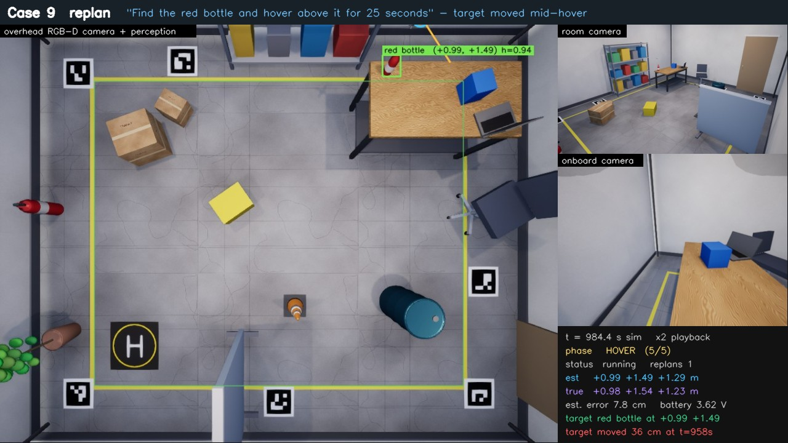

## 6. Ground station


## 7. Experiments on the plant

`matlab/twin/experiments_aeris_twin.m` flies the plant alone (no Python, no model) with one factor varied at a time; `reports/thesis/make_thesis_figures.py` turns the logged signals into the figures and numbers below and into the thesis. Data: [metrics/experiments](metrics/experiments).

**Step responses, true-state feedback, against the linear model of the controller**


**Step responses with the onboard estimator**


**Wind-gust sweep**


**Mass sweep (thrust-to-weight, hover throttle, tracking)**


**Dead-reckoning drift without camera fixes, and the gate of the camera fix**


**Monte Carlo of the validation flight over sensor turn-on biases**


| Quantity | Value |
|---|---|
| Linear model vs measured height step (RMS, cm) | 0.7 |
| Linear model vs measured x step (RMS, cm) | 1.1 |
| Drift runs | 8 |
| Dead-reckoning slope, mean (cm per metre) | 0.15 |
| Heading drift, mean absolute (deg per minute) | 0.08 |
| Monte Carlo runs | 8 |
| Tracking RMSE, mean (cm) | 4.8 |
| Worst arrival error (cm) | 3.6 |
| Worst estimator RMSE (cm) | 2.3 |

## 8. How this run was made, and what it found

All runs: 12 October 2026, LiteWing airframe, `scene_lab`, twin with rendering
on an RTX 3050 laptop (about 0.6-0.7x real time). Videos are time-lapses of
roughly 2-3x simulated time; the simulation clock is on screen in each one.

### Language model used

The project's usual models (`gemini-3.5` to `3.8-flash`) had used up the free
tier's daily quota (20 requests per model) in earlier test runs the same day,
so the recorded run used models that still had quota:

| Run | Model | Result | Kept as |
|---|---|---|---|
| Earlier the same day, not recorded on video | gemini-3.6-flash | 8/8 | `metrics/benchmark_earlier_gemini-3.6-flash.json` |
| Attempt 1 | gemini-flash-lite-latest | 5/8, three flights to the wrong object | `metrics/benchmark_attempt1_before_format_check.json`, `logs/04_language_missions_attempt1.log` |
| Attempt 2, after the format checks below | gemini-flash-lite-latest | 4/8: three refused, one flight to the wrong object | `metrics/benchmark_attempt2_flash-lite.json`, `logs/04_language_missions_attempt2.log` |
| **Reported run (section 4, videos)** | gemini-robotics-er-2-preview | 6/8 on the first pass, 8/8 after cases 1 and 2 were re-run | `metrics/benchmark.json` |
| Replan test (section 5) | gemini-3-flash-preview | pass | `metrics/replan.json` |

Cases 1 and 2 of the reported run were refused on the first pass because
every model call returned 503 or timed out; no flight took place. They were
re-run a few minutes later and are marked `rerun` in `benchmark.json`. Each
case has one scored flight; there are no repeats, so these are single
samples, not averages.

`gemini-flash-lite-latest` is not suitable for this task. It answered with
nine-number arrays, mixed scales such as `[7.32, 143, 198, 770]`, repeated
keys and a negative coordinate, and once boxed the cardboard box when asked
for the yellow crate. The depth check cannot catch that last kind of error:
the box was on a real object, only the wrong one.

### Faults found by the recorded runs, and fixed

| Fault | Effect seen | Fix |
|---|---|---|
| Gyro bias calibration had not converged when the vehicle took off, and kept adapting while the rotors spun up on the pad | Heading drifted about 2.4 deg per minute of flight. After a few missions the position estimate was 18-29 cm out, the camera fixes were refused as too large, and the vehicle hit the partition wall | Bias is the average over a boot window, then only trimmed slowly while still (`+aeris/Sensors.m`). Yaw after the 90 degree step in validation went from 88.2 to 90.1 deg |
| A position fix larger than 12 cm was refused however far the vehicle had flown, so a drifted estimate could never recover | As above | The gate widens with distance flown since the last fix; heading error is measured from each leg and fed back (`backend/vision/scene_service.py`) |
| A model request with no deadline | One overloaded model blocked a mission for several minutes | 30 s deadline, retry on 503 / timeout, then the next model (`backend/models/gemini_provider.py`) |
| Malformed model answers were parsed loosely | A repeated key silently took the second box; a stray bracket discarded a correct answer | First value wins, trailing bracket ignored, a box that is not four non-negative same-scale numbers is asked for again (up to three times) |
| Return-home requested the instant a mission finished was rejected as "mission running" | The next mission started from mid-air | The request waits up to 3 s for the mission thread to finish (`backend/api/routes.py`) |

Unit tests for these are in `backend/tests/test_live_run_fixes.py`.

### Limits of these results

* Estimator error at the scoring moment was 1.0-4.5 cm in the reported run,
  against 0.3-2.3 cm in the earlier run. Over the table edge the height
  estimate was about 6 cm out during the replan test.
* In case 6 the stand-off point is next to the partition wall, so the planner
  holds the vehicle at 1.5 m. The heading is correct, but from that height
  the cone sits at the bottom edge of the onboard camera's view.
* The link check (section 3) flies without the backend, so there are no
  camera fixes: the 4-8 cm arrival errors there are the onboard estimator and
  the arrival tolerance alone.
* The real-time factors in section 2 include model compilation on the first
  of the three runs and vary from run to run.
* The local Qwen models were not tested: with Unreal holding the GPU, one
  Qwen2-VL detection did not finish within 60 s on this PC.
* The dashboard screenshot was taken by a headless browser, which is why its
  simulation-speed chip reads x0.00.

## 9. Cases 10-17: harder wording, 21 October 2026

Same airframe and scene (`scene_lab`), model `gemini-3.6-flash`, run mode `full`, one scored
flight per case. 8/8 after one re-run. Log: `logs/06_new_language_missions.log`; per-trial data
with stage timings and model calls: `metrics/trials_cases10-17.csv`.

* Case 13 ("…if it is in front of the cube, otherwise look at the cube") is scored as "went to the
  bottle, not the cube". The 49 cm in the table is the 0.5 m viewing distance, not an error.
* Case 14 ("the cylindrical object") is ambiguous on purpose. The VLM chose the steel drum.
* Case 16 ("the end of the wall"): the VLM placed the end at (-0.45, -1.34), 19 cm along the wall
  from the true end at (-0.45, -1.15). It passes against the 30 cm tolerance, narrowly.
* Case 17 ("Fly in a star pattern") **failed on the first attempt and found a planner fault**. A
  command with no altitude was planned at the vehicle's current height, which is 0 m on the pad,
  then clamped to the 0.25 m floor limit. One star vertex lies over the 0.23 m yellow crate; the
  route planner refused to fly through it and the mission ended with a controlled landing.
  Fix: from the ground, a command without an altitude now uses the 0.6 m cruise height the
  UAV-VLA pipeline already used (`backend/planning/local_planner.py`, test in
  `backend/tests/test_benchmark_scenarios.py`). The re-run passed. First attempt kept as
  `videos/case17_fly_in_a_star_pattern_attempt1.mp4`, `images/..._attempt1.jpg` and
  `metrics/benchmark_case17_attempt1_before_altitude_fix.json`.

Wrong-object tests with look-alike objects are in [scene_distractor/](scene_distractor/README.md).

